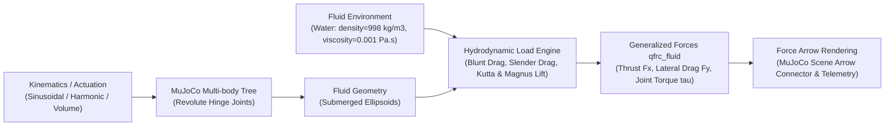

# Tail Testing Simulation: Pivoted Fish Tail Hydrodynamics

This folder contains a dedicated simulation of an oscillating fish caudal tail (fin) mounted to a **Pivot**, immersed in water, with dynamic **Fluid Geometry** loads, granular **force telemetry**, and visual **Force Arrows** matching the experimental schematic.

---

## 1. How the Fish Simulation Works

The fish simulator in this project models fish and robotic eel locomotion using **MuJoCo physics and hydrodynamics**:



### Key Hydrodynamic Principles
1. **Surrounding Medium**: Water density $\rho = 998\ \text{kg/m}^3$ and dynamic viscosity $\mu = 0.001\ \text{Pa}\cdot\text{s}$ configured in the physics engine.
2. **Ellipsoidal Hydrodynamic Forces**:
   - **Blunt Drag ($F_{\text{blunt}}$)**: Normal pressure drag resisting transverse cross-flow:
     $$F_{\text{blunt}} \propto \frac{1}{2} \rho A_{\perp} |\mathbf{v}_{\perp}|^2 C_{\text{blunt}}$$
   - **Slender Drag ($F_{\text{slender}}$)**: Skin friction tangential to the foil profile:
     $$F_{\text{slender}} \propto \frac{1}{2} \rho A_{\parallel} |\mathbf{v}_{\parallel}|^2 C_{\text{slender}}$$
   - **Kutta Lift ($F_{\text{lift}}$)**: Circulation-induced lift acting perpendicular to relative velocity $(\mathbf{v} \times \hat{\mathbf{z}})$, with a direction set by the relative flow.
   - **Magnus Lift ($F_{\text{magnus}}$)**: Force from body rotation in cross flow ($\boldsymbol{\omega} \times \mathbf{v}$).
   - **Rotational Drag**: Hydrodynamic damping torque opposing angular rotation $\boldsymbol{\omega}$.
3. **Force Extraction & Force Arrow Visualization**:
   - In MuJoCo, generalized fluid forces on all degrees of freedom are stored in `data.qfrc_fluid`.
   - By structuring the base fixture with a pinned reference frame (or freejoint), the translational DOFs directly output the exact 3D Cartesian hydrodynamic force vector $\mathbf{F} = (F_x, F_y, F_z)$ in Newtons.
   - Rotational degrees of freedom output hydrodynamic moments and joint reaction torques.
   - Force arrows are rendered from the ellipsoid center of the fluid geometry along $\mathbf{F}$ using MuJoCo's native connector geometries (`mjv_connector` with `mjGEOM_ARROW`).

---

## 2. Tail Testing Setup

The tail testing setup replicates the classic fluid dynamic testing rig for fish caudal fins (as shown in the schematic):

```
       Fluid Geometry (Ellipsoid)
       /-----------------------------------------\
      /                                           \
( O )==============================================>
Pivot                                \
                                      \  Force Arrow (F_hydro)
                                       v
```

- **Pivot**: A cylindrical hinge joint located at the root $(0, 0, 0)$ allowing yaw rotation in the horizontal XY plane.
- **Fluid Geometry**: An elongated streamlined ellipsoid attached to the pivot:
  - Length: $230\ \text{mm}$ (semi-major axis $a = 115\ \text{mm}$)
  - Width / thickness: $32\ \text{mm}$ (semi-minor axis $b = 16\ \text{mm}$)
  - Height / fin depth: $160\ \text{mm}$ (vertical semi-axis $c = 80\ \text{mm}$)
- **Motion**: Oscillatory pitching flapping motion:
  $$\theta(t) = A \sin(2\pi f t)$$
  $$\omega(t) = \dot{\theta}(t) = 2\pi f A \cos(2\pi f t)$$
  $$\alpha(t) = \ddot{\theta}(t) = -(2\pi f)^2 A \sin(2\pi f t)$$
  - Default: $f = 1.0\ \text{Hz}$, $A = 25^\circ$.
- **Force Vector Behavior**:
  - As the tail sweeps upwards ($\dot{\theta} > 0$), water resists the motion with downward lateral drag ($-Y$).
  - The prescribed fixed-pivot sweep makes the ellipsoid center velocity normal to the tail axis. Check the Kutta contribution in telemetry.
  - The force arrow shows the resultant fluid load. Positive X points toward the neutral tail tip.

---

## 3. Telemetry Output: Each Force in the CSV

The output file `tail_telemetry.csv` outputs every force and torque acting on the system at each frame:

| Column Category | Field Name | Description | Units |
|---|---|---|---|
| **Kinematics** | `time_s` | Simulation clock | $\text{s}$ |
| | `angle_deg`, `angle_rad` | Instantaneous pivot flapping angle $\theta$ | $\text{deg}, \text{rad}$ |
| | `angular_velocity_deg_s`, `_rad_s` | Angular velocity $\omega = \dot{\theta}$ | $\text{deg/s}, \text{rad/s}$ |
| | `angular_acceleration_deg_s2`, `_rad_s2` | Angular acceleration $\alpha = \ddot{\theta}$ | $\text{deg/s}^2, \text{rad/s}^2$ |
| **Total Fluid Force** | `fluid_force_x_n` | Global X fluid force (positive toward the neutral tail tip) | $\text{N}$ |
| | `fluid_force_y_n` | Global Y fluid force (lateral hydrodynamic drag) | $\text{N}$ |
| | `fluid_force_z_n` | Global Z fluid force (vertical load) | $\text{N}$ |
| | `fluid_force_mag_n` | Total resultant fluid force magnitude $\|\mathbf{F}\|$ | $\text{N}$ |
| **Body Frame Forces** | `tail_normal_force_n` | Hydrodynamic force normal to the fin surface | $\text{N}$ |
| | `tail_axial_force_n` | Hydrodynamic force along the fin chord line | $\text{N}$ |
| **Aero Decomposition** | `hydrodynamic_lift_n` | Hydrodynamic lift perpendicular to velocity vector | $\text{N}$ |
| | `hydrodynamic_drag_n` | Hydrodynamic drag parallel and opposing velocity | $\text{N}$ |
| **MuJoCo Components** | `blunt_drag_force_x_n`, `_y_n` | Form / pressure drag force from cross-flow | $\text{N}$ |
| | `slender_drag_force_x_n`, `_y_n` | Viscous skin friction drag along the profile | $\text{N}$ |
| | `kutta_lift_force_x_n`, `_y_n` | Circulation-induced Kutta lift force | $\text{N}$ |
| | `magnus_lift_force_x_n`, `_y_n` | Rotational Magnus lift force | $\text{N}$ |
| | `viscous_base_force_x_n`, `_y_n` | Zero-coefficient baseline including Stokes resistance and velocity-dependent added mass | $\text{N}$ |
| **Torques on Pivot** | `total_fluid_torque_nm` | Net hydrodynamic resistive torque on pivot | $\text{N}\cdot\text{m}$ |
| | `angular_drag_torque_nm` | Hydrodynamic rotational damping torque | $\text{N}\cdot\text{m}$ |
| | `blunt_drag_torque_nm` | Torque generated by pressure drag | $\text{N}\cdot\text{m}$ |
| | `joint_damping_torque_nm` | Mechanical joint damping torque ($-d\cdot\omega$) | $\text{N}\cdot\text{m}$ |
| | `inertial_torque_nm` | Fin structural inertial torque ($I\cdot\alpha$) | $\text{N}\cdot\text{m}$ |
| | `actuator_required_torque_nm`| Net actuator drive torque needed ($I\alpha - \tau_{\text{fluid}} - \tau_{\text{damp}}$) | $\text{N}\cdot\text{m}$ |
| **Position** | `geom_x_m`, `geom_y_m`, `geom_z_m` | Center of pressure position of the fluid geometry | $\text{m}$ |

---

## 4. How to Run

All commands run using the existing virtual environment from the project root:

### Quick Run
```sh
./.venv/bin/python -m src.tail_test.run_tail_simulation
```

### Run with Perspective View (3D Angle)
```sh
./.venv/bin/python -m src.tail_test.run_tail_simulation --camera perspective
```

### Interactive 3D Real-Time Viewer
```sh
./.venv/bin/python .venv/bin/mjpython -m src.tail_test.run_tail_simulation --view
```
